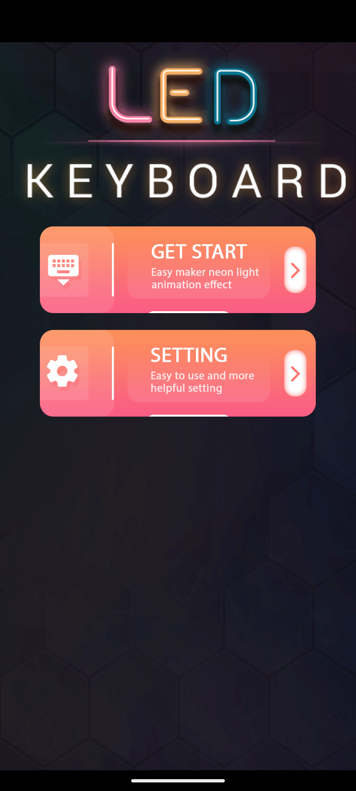
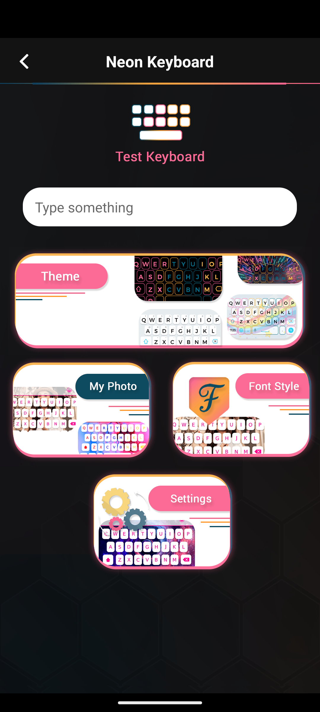
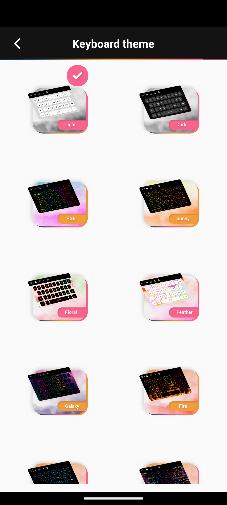
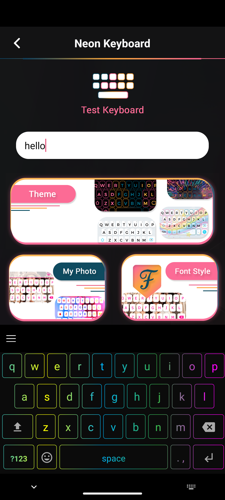
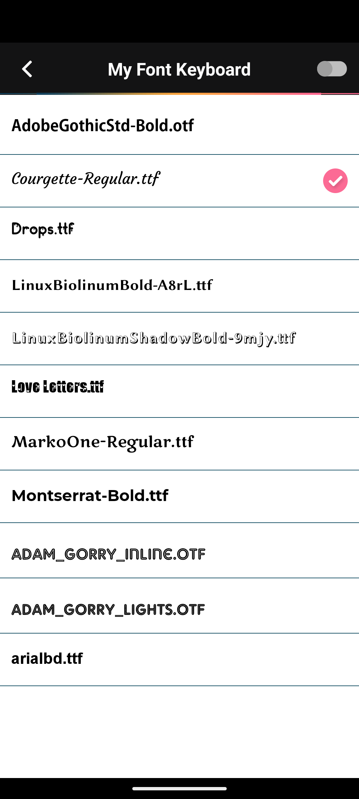
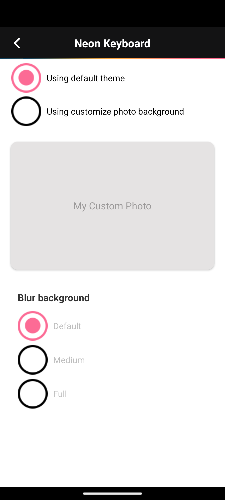
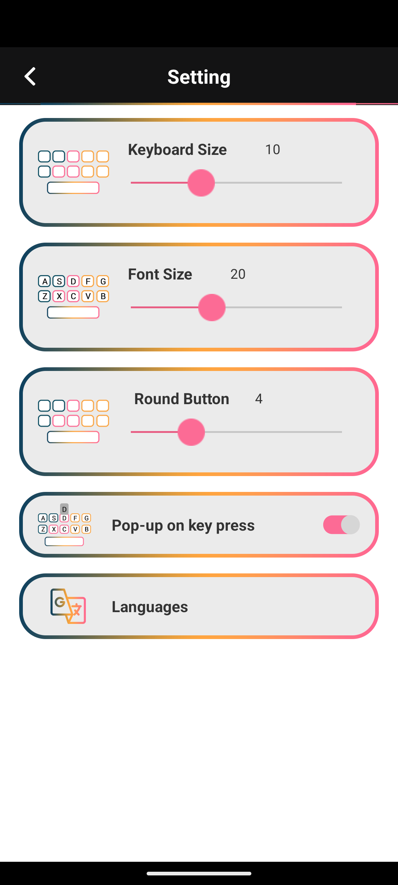

<div align="center">


# Neon LED Light Keyboard

**A glowing neon LED keyboard for Android** — neon rainbow themes, custom fonts, GIFs, emojis, key-press sounds and photo wallpapers. Built as an InputMethodService (IME) with AdMob monetization.

   

</div>

---

## 📱 Screenshots

*Captured live from the app running on an Android 15 emulator.*

<div align="center">

| Onboarding | Home | Theme gallery |
|:---:|:---:|:---:|
|  |  |  |

| **Neon keyboard** | Font style | My photo |
|:---:|:---:|:---:|
|  |  |  |

| Settings |
|:---:|
|  |

</div>

## ✨ Features

- **Neon LED themes** — multiple glowing theme packs with live previews and a theme gallery
- **Photo keyboard** — set any picture (camera roll or crop from gallery) as your keyboard wallpaper
- **Font styles** — switch typing fonts from the built-in font gallery
- **GIF keyboard** — search and insert GIFs powered by the Tenor API
- **Emojis, key-press sounds and animations**
- **Multi-language layouts** with language switching
- **Onboarding flow** — enable keyboard → select keyboard → start typing
- **Splash animation** (`splash.mp4`)
- **AdMob monetization** — banner + interstitial pre-wired with Google test IDs

## 🔧 Getting Started

```bash
git clone https://github.com/Awaisdev01/neon-led-light-keyboard.git
cd neon-led-light-keyboard
# open in Android Studio, let Gradle sync, run
```

- **Requirements:** Android Studio with JDK 11, Gradle 7.0.2 (wrapper included)
- **Package:** `com.demo.example.neonkeyboard` — the IME service is `MyKeyboard.SoftKeyboard`

## ⚠️ Before Publishing to Google Play

1. Rename the application ID / package (`com.demo.example.neonkeyboard`)
2. Replace the AdMob **test IDs** (`/6499/example/...`) in `AdAdmob.java` with your real ad unit IDs
3. Replace the Tenor public sandbox key in `MyApplication.java` with your own [Tenor API key](https://developers.google.com/tenor)
4. Update the app name, icon and store listing

## 📂 Project Structure

```
neon-led-light-keyboard/
├── app/src/main/
│   ├── java/com/demo/example/neonkeyboard/ledkeyboard/
│   │   ├── MyKeyboard/SoftKeyboard.java   # The IME service
│   │   ├── AdAdmob.java                   # AdMob banner + interstitial
│   │   ├── ThemeActivity, FontActivity, MyphotoActivity, SettingActivity…
│   │   └── MyGif/                         # Tenor GIF picker
│   ├── res/
│   │   ├── drawable-nodpi/                # Theme previews & UI art
│   │   ├── font/  keypress/  raw/         # Fonts, key sounds, splash video
│   │   └── xml/                           # Keyboard method declarations
│   └── AndroidManifest.xml
└── screenshots/                           # Live app screenshots
```

## 📝 Build fixes applied

- **Tenor SDK** upgraded `0.5.0 → 0.5.1` (0.5.0 no longer resolves on any public repo) and app code adapted to the 0.5.1 API — `BaseError`, `WeakRefOnScrollListener` and the click-utility are now small local shims
- **RecycleClick** library (upstream deleted) replaced with two local utility classes with the same API
- **Android Image Cropper** now resolves via the Aliyun jcenter mirror (the original jcenter is gone)
- Repository lists cleaned up and de-duplicated

---

## 📬 Contact

Open for work and business inquiries — **awaisdev5765@gmail.com**

<div align="center">

*Type in neon* ✨

</div>
